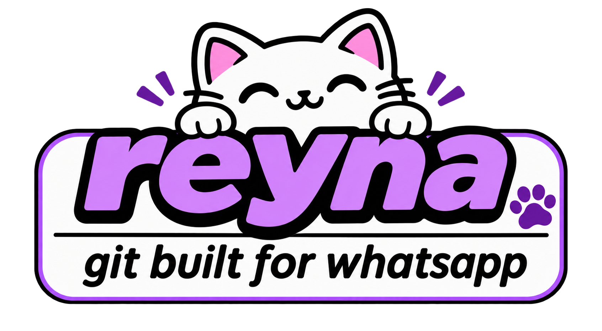

<div align="center">
  
  <br/>
  <br/>
  <a href="https://golang.org"></a>
  <a href="https://react.dev"></a>
  <a href="https://nodejs.org"></a>
  <a href="https://ai.google.dev"></a>
  <a href="LICENSE"></a>
</div>

reyna is an autonomous document capture, semantic indexing, and conversational retrieval system for WhatsApp.

Every day, countless critical documents—research papers, project decks, technical specs, financial reports, spreadsheets, contracts, and notes—get dumped into WhatsApp group chats, only to be buried under thousands of messages within hours. Reyna transforms WhatsApp into an intelligent, self-organizing document intelligence hub.

The moment a document is shared in any monitored chat, Reyna intercepts it, analyzes the inner contents, organizes it into structured Google Drive folders, and indexes its text in a local SQLite database. When you need that file days or months later, ask Reyna naturally in WhatsApp DM or through the web dashboard—Reyna retrieves the exact file, drops a direct Google Drive link, and answers specific questions cited directly from the document.

Highlights
----------

- **Autonomous Ingestion** // Intercepts and captures PDFs, Word documents, PowerPoint presentations, spreadsheets, and files from WhatsApp chats with zero manual effort
- **Deep Content Analysis** // Reads inside document text to determine intelligent categorization instead of guessing from arbitrary file names
- **Instant Conversational Retrieval** // Search documents and ask questions in plain language via WhatsApp DM or web interface with verified citations and direct Drive links
- **Multilingual Intelligence** // Understands queries and answers fluently across English, Hindi, Hinglish, and regional languages
- **Zero-Dependency Office Engine** // Unpacks and parses DOCX, PPTX, and XLSX archives using the Go standard library with zero external binaries
- **Ranked SQL Search Engine** // Sub-millisecond token matching and relevance scoring directly in SQLite with intelligent stopword filtering
- **100% Self-Hosted & Private** // Every file and extracted summary remains strictly in your personal Google Drive and local SQLite database; no third-party data tracking

Table of Contents
-----------------

<!-- vim-markdown-toc GFM -->

* [Highlights](#highlights)
* [Architecture and Pipeline](#architecture-and-pipeline)
* [Installation](#installation)
    * [Prerequisites](#prerequisites)
    * [Setup](#setup)
* [Running Reyna](#running-reyna)
    * [Service Execution](#service-execution)
    * [Validating Environment](#validating-environment)
* [Task Runner Recipes](#task-runner-recipes)
* [Usage](#usage)
    * [WhatsApp Bot Group Commands](#whatsapp-bot-group-commands)
    * [WhatsApp Bot Direct Messages](#whatsapp-bot-direct-messages)
    * [Web Dashboard](#web-dashboard)
* [Configuration](#configuration)
* [Privacy and Security](#privacy-and-security)
* [License](#license)

<!-- vim-markdown-toc -->

Architecture and Pipeline
-------------------------

Every file ingested by Reyna traverses a seven-stage processing pipeline before landing in Google Drive:

1. **Hash Deduplication**: Computes SHA-256 byte hashes to identify duplicate uploads across all monitored groups. The same file shared across multiple channels is stored once, while revised files sharing an identical name are automatically versioned (`v2`).
2. **Office Document Parsing**: Ingests DOCX, PPTX, and XLSX archives in memory using Go standard library `archive/zip` and `encoding/xml`. Inner XML files are parsed into plain text with zero external toolchain requirements.
3. **Tokenization and Normalization**: Strips conversational stopwords across English and Hinglish to isolate substantive search tokens.
4. **Ranked SQL Search**: Scores documents against queries using custom token matches executed inside SQLite.
5. **Fuzzy Folder Matching**: Computes Jaccard similarity between suggested category names and existing Google Drive directories to prevent duplicate or near-identical folders.
6. **Gemini Classification**: Analyzes document contents alongside sender metadata, timestamps, and current folder hierarchies to determine the optimal destination folder.
7. **Google Drive Synchronization**: Streams file bytes to Google Drive v3, resolves destination folders, and applies view permissions so generated links work seamlessly.

Installation
------------

### Prerequisites

Ensure the following tools are installed on your system:

- Go 1.22 or higher
- Node.js 20 or higher and npm
- [just](https://github.com/casey/just) task runner
- Google Cloud OAuth credentials (with Google Drive API enabled)
- Google AI Studio Gemini API key

### Setup

Clone the repository and initialize the configuration file:

```sh
git clone https://github.com/hurshnarayan/reyna.git
cd reyna
just env-init
```

`just env-init` creates a `.env` file populated with cryptographically random keys for `JWT_SECRET` and `DEVICE_TOKEN`.

Open `.env` and provide your credentials:

```env
GEMINI_API_KEY=your_gemini_api_key
GOOGLE_CLIENT_ID=your_oauth_client_id.apps.googleusercontent.com
GOOGLE_CLIENT_SECRET=your_oauth_client_secret
```

Install frontend and bot dependencies:

```sh
just install
```

Running Reyna
-------------

### Service Execution

Reyna comprises three core components that run in separate terminals:

```sh
# Terminal 1: Go backend API server (runs on http://localhost:8080)
just backend

# Terminal 2: React Vite web dashboard (runs on http://localhost:5173)
just frontend

# Terminal 3: Baileys WhatsApp bot daemon
just bot
```

On first startup of `just bot`, scan the terminal QR code using WhatsApp (Linked Devices > Link a Device).

> [!NOTE]
> The WhatsApp bot automatically outputs a live pairing QR code as an SVG to `web/public/qr.svg`, accessible in your browser at `http://localhost:5173/qr.svg`.

> [!TIP]
> The bot daemon includes single-instance process locking via `.bot.pid`. Starting `just bot` automatically terminates any stale background instance to prevent connection replacement conflicts (code 440).

### Validating Environment

Run the built-in doctor command to verify your toolchains, environment variables, and active services:

```sh
just doctor
```

Task Runner Recipes
-------------------

The repository provides a `justfile` managing build, execution, and cleanup tasks:

| Command | Description |
| ------- | ----------- |
| `just doctor` | Checks toolchains, configurations, dependencies, and service reachability |
| `just env-init` | Generates a `.env` file with fresh `JWT_SECRET` and `DEVICE_TOKEN` |
| `just install` | Installs npm dependencies for both `web/` and `whatsapp-bot/` |
| `just build` | Compiles the Go server binary and builds Vite production assets |
| `just backend` | Runs the Go backend server on port 8080 |
| `just frontend` | Runs the Vite development server on port 5173 |
| `just bot` | Runs the WhatsApp bot daemon with process lock protection |
| `just fresh` | Removes the local SQLite database and starts a fresh backend |
| `just clean` | Removes database files, local drive cache, and saved bot credentials |
| `just dev` | Prints service startup instructions for multi-terminal execution |

Usage
-----

### WhatsApp Bot Group Commands

Add the bot's WhatsApp account to any group and issue commands in the group chat:

- `/reyna init`: Enables document capture in the current group.
- `/reyna mode auto`: Switches to automatic mode, capturing every document shared in the group.
- `/reyna mode reaction`: Switches to reaction mode, staging only documents that receive the trigger reaction.
- `/reyna emoji [emoji]`: Sets the trigger emoji for reaction staging (default: 📌).
- `/reyna stop`: Pauses tracking for the current group.

### WhatsApp Bot Direct Messages

Send direct messages to the bot number to search and ask questions:

```
User:  reyna find q3 financial report
Reyna: Found 2 files:
       1. Q3_FY25_Financial_Review.pdf (Finance) - https://drive.google.com/...
       2. Board_Meeting_Deck_Q3.pptx (Executive) - https://drive.google.com/...

User:  what was the net margin in q3?
Reyna: According to Q3_FY25_Financial_Review.pdf (page 6), the operating net margin
       was 24.3%, an increase of 180 basis points over Q2.
```

Follow-up questions do not require the `reyna` prefix for 10 minutes following a reply.

### Web Dashboard

Access the interface at `http://localhost:5173`:

- **Dashboard**: High-level overview displaying committed storage, group counts, active tracking status, and recent documents.
- **Files**: Complete file repository featuring subject pill filters, sort toggles, live document preview, download links, and batch deletion.
- **Groups**: Central management for connected groups. Toggle tracking on or off, switch between auto and reaction capture, customize reaction emojis, and remove groups.
- **Staging**: Staging queue for reaction-mode documents awaiting batch commit to Google Drive.

Configuration
-------------

The following variables can be configured in `.env`:

| Variable | Description | Default |
| -------- | ----------- | ------- |
| `PORT` | HTTP port for the Go backend server | `8080` |
| `BACKEND_URL` | Backend URL used by the WhatsApp bot | `http://localhost:8080` |
| `DEVICE_TOKEN` | Shared authentication token between bot and backend | Required |
| `JWT_SECRET` | Signing key for web user session tokens | Required |
| `GEMINI_API_KEY` | Google AI Studio API key | Required |
| `GEMINI_MODEL` | Gemini model identifier used for analysis | `gemini-3.8-flash` |
| `GOOGLE_CLIENT_ID` | OAuth 2.0 client ID for Google Drive | Required |
| `GOOGLE_CLIENT_SECRET` | OAuth 2.0 client secret for Google Drive | Required |
| `GOOGLE_REDIRECT_URL` | OAuth redirect URL | `http://localhost:8080/api/auth/google/callback` |
| `AUTH_DIR` | Directory storing Baileys session credentials | `./auth_state` |

Privacy and Security
--------------------

Reyna processes files locally and streams them directly into your Google Drive:

- Files and text extractions are stored in your own SQLite database and Google Drive.
- Group messages are monitored only in groups explicitly activated via `/reyna init`.
- The bot only interacts with groups where it has been added and enabled.
- For sensitive contexts, reaction mode ensures that only intentionally pinned documents are captured.

License
-------

The MIT License (MIT)

Copyright (c) 2026 Harsh Narayan
